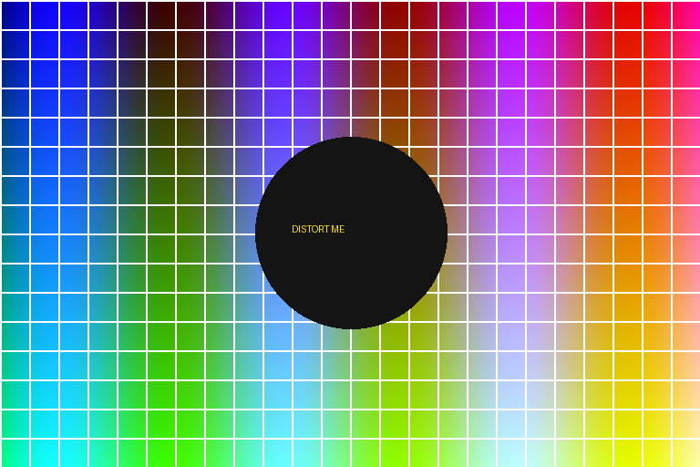
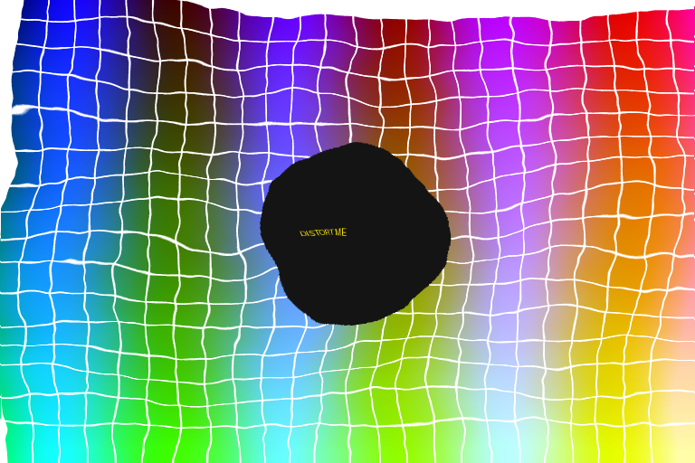
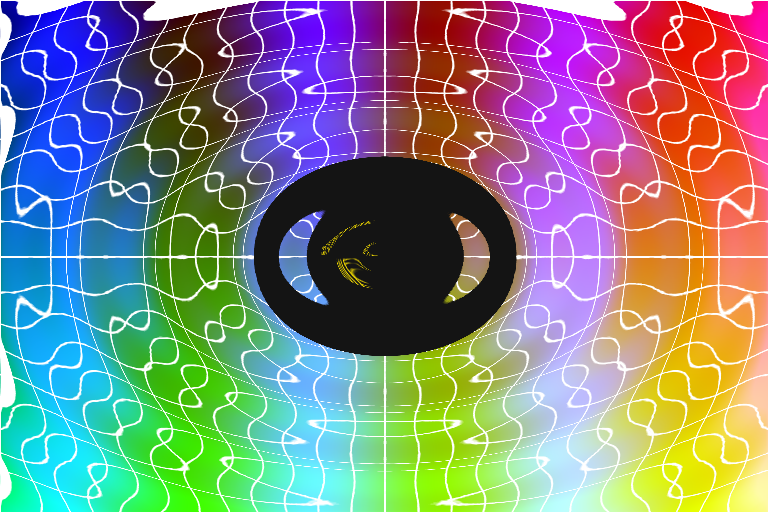
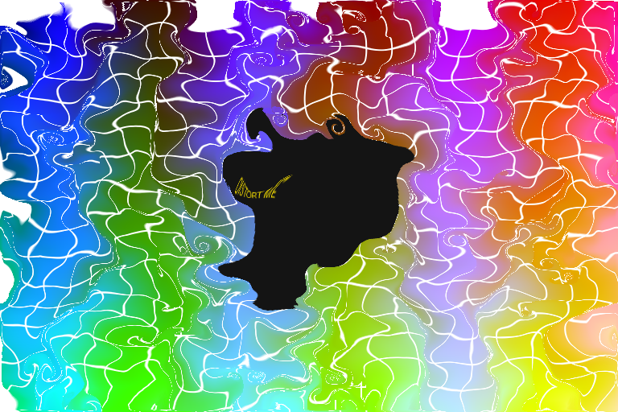

# Distort Me

Free, image-driven distortion for Photoshop on Windows and macOS.

Every effect in Distort Me is steered by an image, a "map". A scan of crumpled paper, a marble texture or a photo of water decides where each pixel of your artwork moves.

> **Status:** early development. The distortion core and a command-line test tool work. The Photoshop filter plugin comes next.

| Source | Displace | Refract | Flow |
| --- | --- | --- | --- |
|  |  |  |  |

## Modes

| Mode | What the map controls |
| --- | --- |
| `displace` | Red shifts pixels left/right, green shifts them up/down. 50 % grey means no shift, like Photoshop's Displace filter. With `--luminance`, brightness pushes along `--angle`. |
| `refract` | The map is a sheet of glass whose thickness follows its brightness. Light bends through it (Snell's law, `--ior`). |
| `flow` | Pixels travel along the map's lines of equal brightness (or uphill with `--uphill`), which smears the image like ink in water. |

## Build

You need CMake 3.16+ and a C compiler: Visual Studio 2022 on Windows, Xcode command-line tools on macOS, gcc or clang on Linux.

```sh
cmake -S . -B build
cmake --build build --config Release
ctest --test-dir build -C Release
```

The test tool ends up in `build/` (`build/Release/` with Visual Studio).

## Try it

```sh
distortme samples/source.png samples/map_noise.png out.png --mode displace --strength 25
distortme samples/source.png samples/map_ripple.png out.png --mode refract --strength 60
distortme samples/source.png samples/map_marble.png out.png --mode flow --strength 40
```

Run `distortme` without arguments to list all options.

## Layout

```
include/distortme.h   public API of the core (plain C99)
src/                  core: map preparation, the three modes, threading
cli/                  command-line test tool (uses stb_image)
tests/                core tests, run with ctest
samples/              test image and maps
third_party/stb/      stb_image and stb_image_write (public domain / MIT)
```

The core knows nothing about Photoshop. The plugin will be a thin wrapper around it.

## Photoshop SDK

The Photoshop plugin needs Adobe's Photoshop Plug-In SDK, which you download yourself from the Adobe Developer Console. Its license does not allow redistribution, so it is never part of this repository.

## License

MIT, see [LICENSE](LICENSE). Bundled maps will list their source in `CREDITS.md`.
